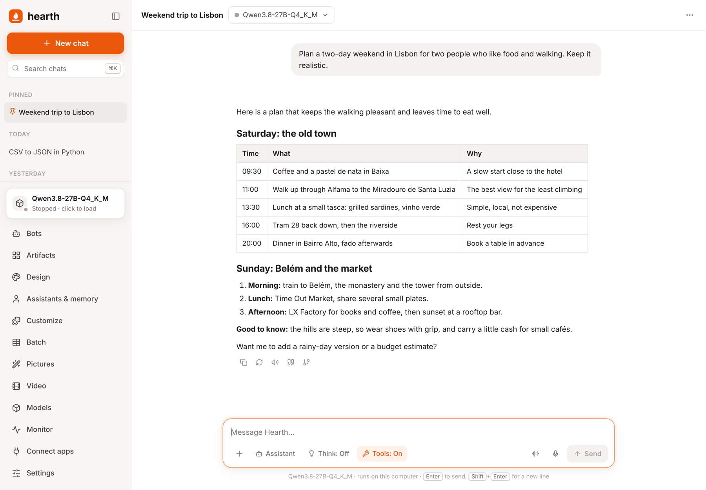
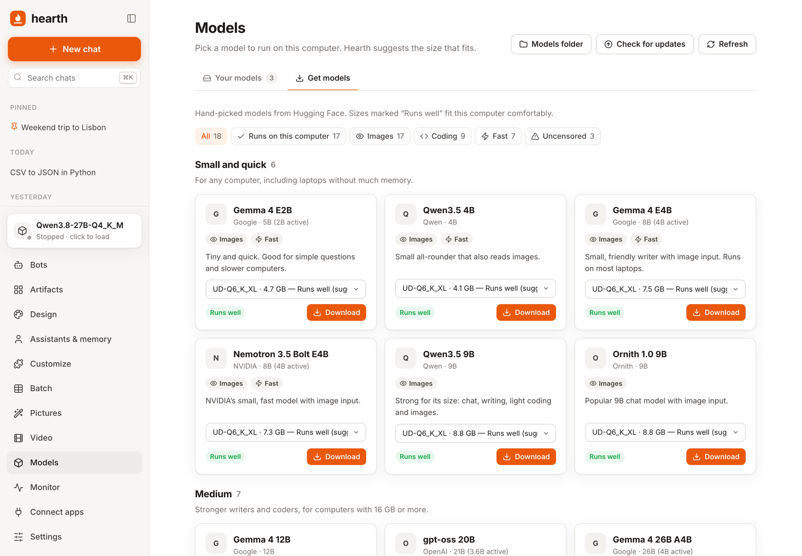
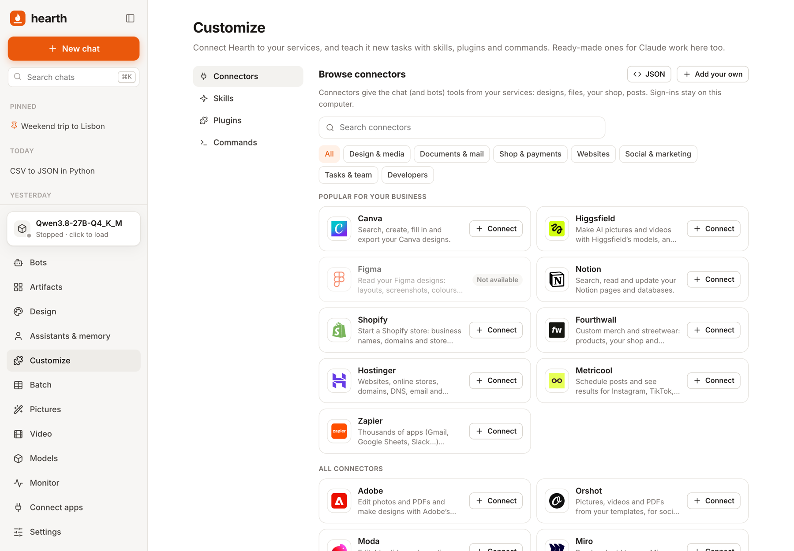
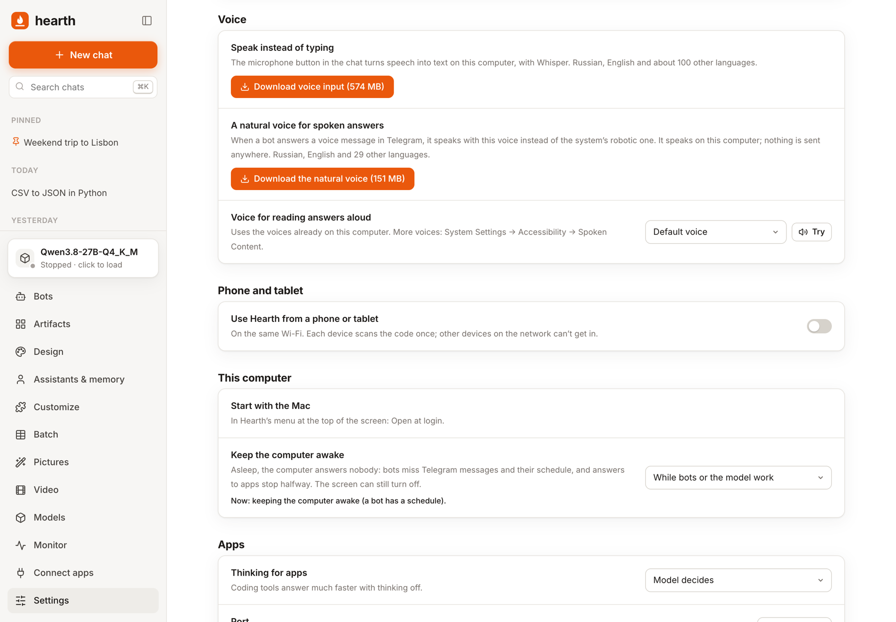
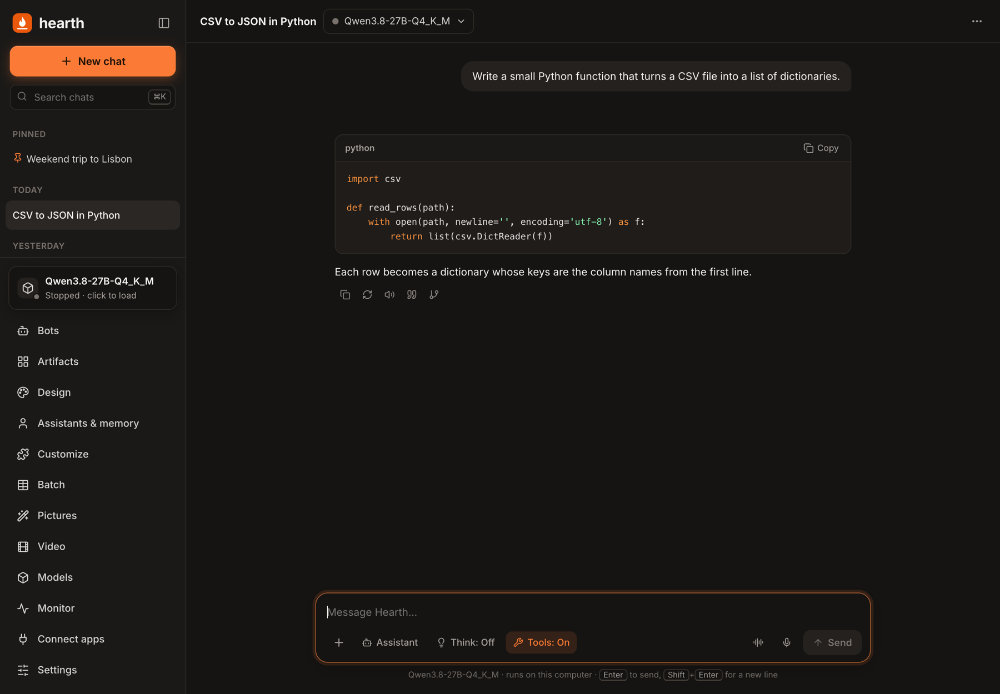

<p align="center">
  
</p>

<h1 align="center">Hearth</h1>

<p align="center">
  <b>Run AI models on your own computer.</b><br>
  Chat, documents, voice, pictures, video and bots that work for you, with nothing leaving your machine.
</p>

<p align="center">
  <a href="https://viking818.github.io/hearth/">Website</a> ·
  <a href="README.ru.md">Русский</a> ·
  <a href="#download">Download</a> ·
  <a href="docs/FEATURES.md">All features</a> ·
  <a href="#privacy">Privacy</a>
</p>



Hearth is a free desktop app for Mac and Windows (and Linux, from source). It downloads open AI models, runs them on
your processor or graphics card with [llama.cpp](https://github.com/ggml-org/llama.cpp), and gives you one place to
use them: a chat, bots, a picture and video maker, and a local API for coding tools. No account, no subscription, no
cloud. The interface speaks English and Russian.

## What you can do with it

- **Chat** with text, images and documents (PDF, Word, Excel, PowerPoint). Search every chat, branch a conversation,
  quote a message, pin and archive.
- **Let the model look things up.** It searches the web, opens pages (also the ones built by scripts) and reads the
  folders you allow. Every step shows in the chat.
- **Talk to it.** Speak instead of typing, or have a whole conversation by voice. Speech is recognized on your
  computer.
- **Bots that work on their own.** Give a bot a task or a schedule, and write to it from your phone through its own
  Telegram bot, by text or by voice. It reads the files you send and writes documents and tables back.
- **Pictures and video.** Draw pictures and make short clips with sound, on your own graphics card.
- **Design and artifacts.** Posters, social posts, logos and small web apps the model writes, with live preview.
- **Batch work.** One instruction for hundreds of photos or files, saved as an Excel table.
- **Use the model in other apps.** A local OpenAI-compatible and Anthropic-compatible API for Claude Code, Codex and
  anything else that speaks them.
- **Connectors, skills and plugins** in Claude's formats, with a directory of about 60 services.
- **From your phone.** Scan a QR code and use the whole app from a phone or tablet on the same Wi-Fi.

The full list, with the details, is in [docs/FEATURES.md](docs/FEATURES.md).

| | |
| --- | --- |
|  **Models:** Hearth checks your computer and marks the sizes that run well. |  **Customize:** connect your services, add skills, plugins and commands. |
|  **Voice:** speech to text, and a natural voice for spoken answers. |  **Light and dark** themes. |

<sub>The screenshots show sample data.</sub>

## Download

Get the newest files from the [Releases page](https://github.com/Viking818/hearth/releases/latest).

| Computer | File | How |
| --- | --- | --- |
| **Windows 10 or 11** (64-bit) | `Hearth-Setup-<version>.exe` | Run it. No administrator rights are needed. It adds Start menu and desktop shortcuts. |
| **Windows, without installing** | `Hearth-Windows-<version>.zip` | Unzip it anywhere and double-click `Hearth.vbs`. |
| **Mac with Apple Silicon** (M1 or newer) | `Hearth-<version>-mac-arm64.zip` | Unzip it and move **Hearth** to Applications. |
| **Linux, or a Mac with an Intel chip** | the source code | See [Run from source](#run-from-source). |

Node.js comes inside the Windows and Mac packages, so there is nothing else to install.

**The first start shows a warning, because the packages are not signed yet:**

- **Windows:** SmartScreen says "Windows protected your PC". Click **More info**, then **Run anyway**.
- **Mac:** macOS says the app cannot be opened. Open **System Settings → Privacy & Security**, scroll down and click
  **Open Anyway** next to Hearth. (Or run `xattr -dr com.apple.quarantine /Applications/Hearth.app` in Terminal once.)

### First steps

1. Open **Models**. Hearth shows your processor, memory and graphics card.
2. Click **Download engine** if the Engine card asks for it. Hearth picks the right build: Metal on a Mac, CUDA for
   NVIDIA, Vulkan or ROCm for AMD Radeon, or the processor alone.
3. Under **Get models**, pick a model marked **Runs well** and download it. Models you already have in LM Studio,
   Ollama or the Hugging Face cache are found and used as they are.
4. Click **Load** and start chatting.

### What your computer needs

- **Memory:** 16 GB runs the small models well; 32 GB or more runs the strong ones. A graphics card with 8 GB or more
  makes everything faster, but is not required.
- **Disk:** a model takes from 4 GB to 80 GB. Pictures need about 11 GB more, video about 25 GB more.
- Hearth ships no model and no engine. It downloads what you choose, when you press Download.

## Privacy

- Hearth runs on your computer and listens on `127.0.0.1` only. Your chats and files stay in your own data folder.
- Nothing is sent anywhere unless you use a tool that needs the internet: a web search, opening a page, a connector you
  switched on, or a Telegram bot you connected.
- Web tools open public addresses only, never your computer or home network. Bots write only inside their own work
  folder.
- Everything downloaded to run (engines, voices) comes from its maker's official releases and is checked against a
  checksum first.

More in [docs/FEATURES.md](docs/FEATURES.md#privacy-and-safety).

## Run from source

You need [Node.js](https://nodejs.org) 20 or newer. Hearth has no other dependencies and no build step.

```sh
git clone https://github.com/Viking818/hearth.git
cd hearth
npm start          # opens http://127.0.0.1:7420
npm test           # the test suite: no model, graphics card or network needed
```

Build the packages yourself (on a Mac):

```sh
mac/build.sh              # dist/Hearth.app
windows/package.sh        # dist/Hearth-Windows-<version>.zip and, with NSIS installed, Hearth-Setup-<version>.exe
```

The website in `docs/` is written by `node scripts/build-site.mjs` (both languages from one list of words).

A map of the code is at the end of [docs/FEATURES.md](docs/FEATURES.md#for-developers).

## Status

Hearth is a personal project that is used every day on a Mac (Apple Silicon) and on a Windows PC with an AMD Radeon
card. It is young and changes often. Bug reports are welcome in
[Issues](https://github.com/Viking818/hearth/issues); answers may take a while.

## Credits

Hearth was inspired by [Strata](https://github.com/Niko1221/Strata). It stands on the work of others:
[llama.cpp](https://github.com/ggml-org/llama.cpp), [whisper.cpp](https://github.com/ggml-org/whisper.cpp),
[stable-diffusion.cpp](https://github.com/leejet/stable-diffusion.cpp),
[sherpa-onnx](https://github.com/k2-fsa/sherpa-onnx), [Colibri](https://github.com/JustVugg/colibri),
[PDF.js](https://mozilla.github.io/pdf.js/), [Preact](https://preactjs.com), [Lucide](https://lucide.dev) and the
makers of the open models. The full list with licenses is in [THIRD-PARTY-NOTICES.md](THIRD-PARTY-NOTICES.md).

## License

[MIT](LICENSE). The models and engines Hearth downloads have their own licenses.
