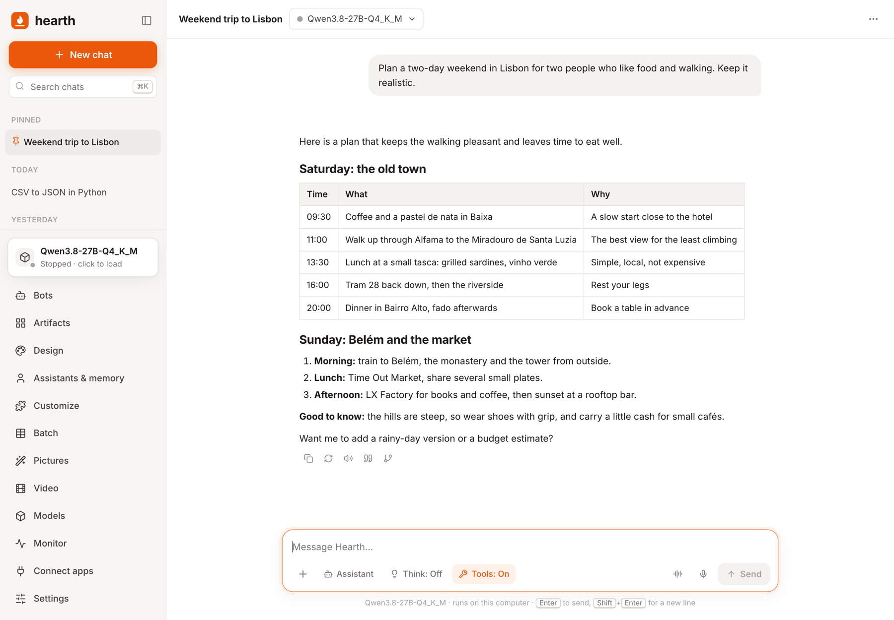
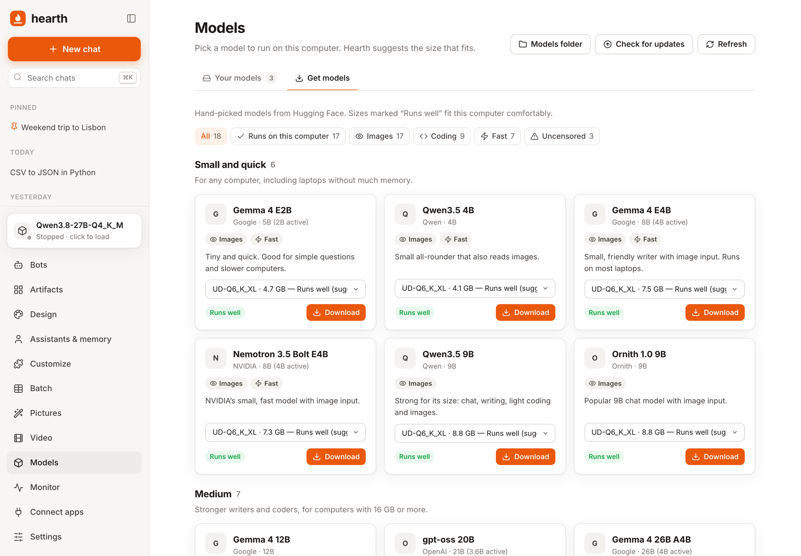
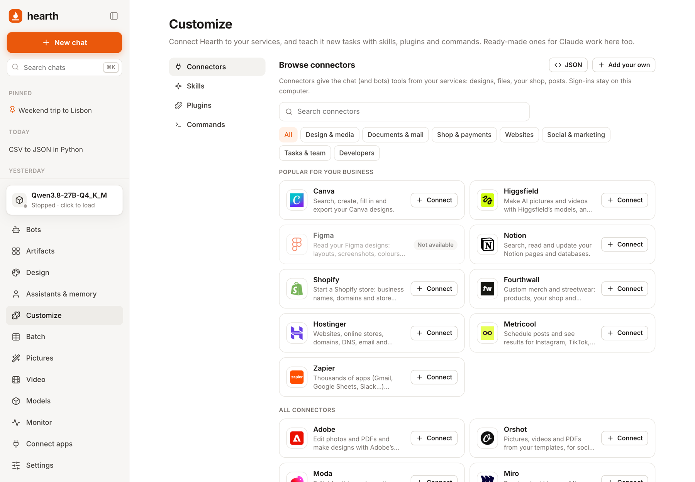
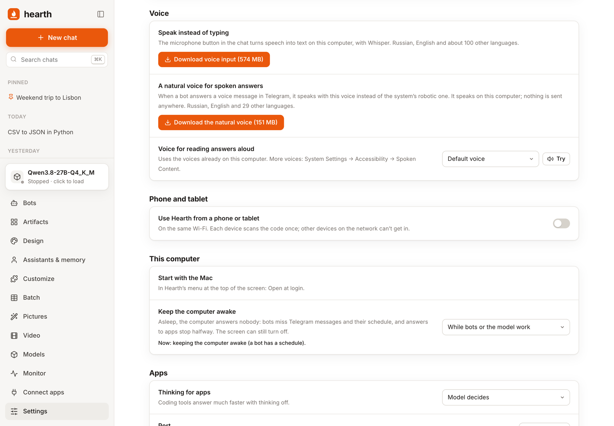
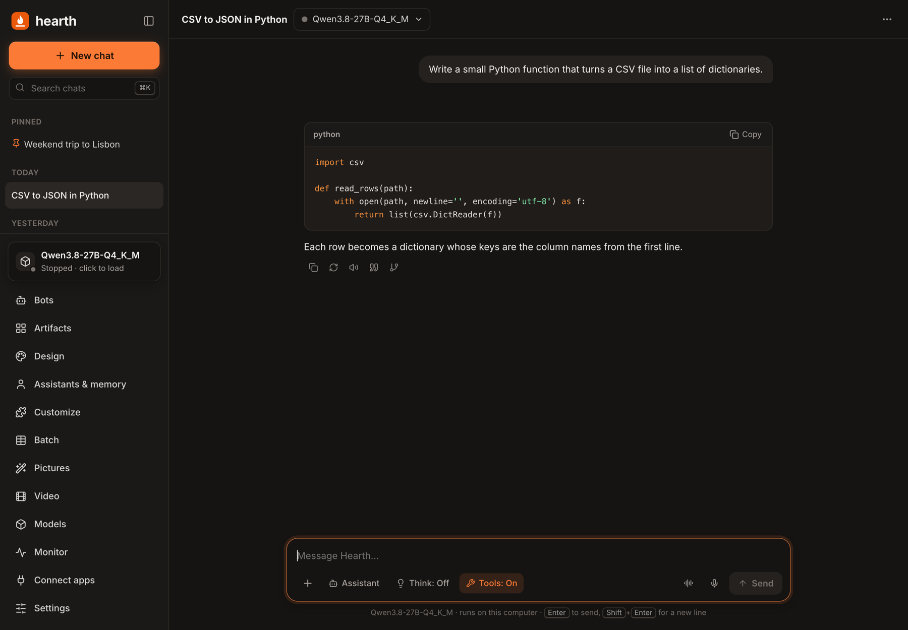

<p align="center">
  
</p>

<h1 align="center">Hearth</h1>

<p align="center">
  <b>Модели ИИ на вашем компьютере.</b><br>
  Чат, документы, голос, картинки, видео и боты, которые работают за вас. Ничего не уходит с вашего компьютера.
</p>

<p align="center">
  <a href="https://viking818.github.io/hearth/ru/">Сайт</a> ·
  <a href="README.md">English</a> ·
  <a href="#скачать">Скачать</a> ·
  <a href="docs/FEATURES.md">Все возможности (англ.)</a> ·
  <a href="#приватность">Приватность</a>
</p>



Hearth — бесплатная программа для Mac и Windows (и для Linux, из исходного кода). Она скачивает открытые модели ИИ,
запускает их на процессоре или видеокарте через [llama.cpp](https://github.com/ggml-org/llama.cpp) и даёт одно место
для работы с ними: чат, боты, картинки и видео, а также локальный API для программ. Без аккаунта, без подписки, без
облака. Интерфейс на русском и английском.

## Что она умеет

- **Чат** с текстом, картинками и документами (PDF, Word, Excel, PowerPoint). Поиск по всем чатам, ветки разговора,
  цитаты, закрепление и архив.
- **Модель сама ищет.** Она ищет в интернете, открывает страницы (в том числе те, что строятся скриптами) и читает
  папки, которые вы разрешили. Каждый шаг виден в чате.
- **Голос.** Можно говорить вместо набора текста или вести весь разговор голосом. Речь распознаётся на вашем
  компьютере.
- **Боты, которые работают сами.** Дайте боту задачу или расписание и пишите ему с телефона через его собственный
  бот в Telegram, текстом или голосом. Он читает присланные файлы и присылает в ответ документы и таблицы.
- **Картинки и видео.** Рисует картинки и делает короткие ролики со звуком на вашей видеокарте.
- **Дизайн и артефакты.** Афиши, посты для соцсетей, логотипы и небольшие веб-приложения, которые пишет модель, с
  живым предпросмотром.
- **Пакетная обработка.** Одна инструкция для сотен фото или файлов, результат — таблица Excel.
- **Модель в других программах.** Локальный API, совместимый с OpenAI и Anthropic: для Claude Code, Codex и всего, что
  умеет с ними работать.
- **Коннекторы, навыки и плагины** в форматах Claude, с каталогом примерно из 60 сервисов.
- **С телефона.** Отсканируйте QR-код и пользуйтесь всей программой с телефона или планшета в той же сети Wi-Fi.

Полный список с подробностями — в [docs/FEATURES.md](docs/FEATURES.md) (на английском).

| | |
| --- | --- |
|  **Модели:** Hearth проверяет ваш компьютер и отмечает размеры, которые на нём хорошо работают. |  **Настроить:** подключайте свои сервисы, добавляйте навыки, плагины и команды. |
|  **Голос:** речь в текст и живой голос для голосовых ответов. |  **Светлая и тёмная** темы. |

<sub>На снимках экрана — демонстрационные данные.</sub>

## Скачать

Свежие файлы лежат на [странице выпусков](https://github.com/Viking818/hearth/releases/latest).

| Компьютер | Файл | Что делать |
| --- | --- | --- |
| **Windows 10 или 11** (64 бита) | `Hearth-Setup-<версия>.exe` | Запустить. Права администратора не нужны. Появятся ярлыки в меню «Пуск» и на рабочем столе. |
| **Windows, без установки** | `Hearth-Windows-<версия>.zip` | Распаковать в любую папку и дважды щёлкнуть `Hearth.vbs`. |
| **Mac с Apple Silicon** (M1 и новее) | `Hearth-<версия>-mac-arm64.zip` | Распаковать и перенести **Hearth** в «Программы». |
| **Linux или Mac с процессором Intel** | исходный код | См. [Запуск из исходного кода](#запуск-из-исходного-кода). |

Node.js уже внутри пакетов для Windows и Mac, ставить больше ничего не нужно.

**При первом запуске будет предупреждение, потому что пакеты пока не подписаны:**

- **Windows:** SmartScreen пишет «Система Windows защитила ваш компьютер». Нажмите **Подробнее**, затем **Выполнить
  в любом случае**.
- **Mac:** macOS пишет, что программу не удаётся открыть. Откройте **Системные настройки → Конфиденциальность и
  безопасность**, прокрутите вниз и нажмите **Всё равно открыть** рядом с Hearth. (Или один раз выполните в Терминале
  `xattr -dr com.apple.quarantine /Applications/Hearth.app`.)

### Первые шаги

1. Откройте **Модели**. Hearth покажет процессор, память и видеокарту.
2. Нажмите **Скачать движок**, если карточка «Движок» об этом просит. Hearth сам выберет сборку: Metal на Mac, CUDA
   для NVIDIA, Vulkan или ROCm для AMD Radeon, либо только процессор.
3. На вкладке **Получить модели** выберите модель с пометкой **Работает хорошо** и скачайте её. Модели, которые уже
   есть в LM Studio, Ollama или кэше Hugging Face, находятся сами и используются как есть.
4. Нажмите **Загрузить** и начинайте чат.

### Что нужно компьютеру

- **Память:** 16 ГБ хватает для небольших моделей, от 32 ГБ — для сильных. Видеокарта с 8 ГБ и больше всё ускоряет,
  но не обязательна.
- **Диск:** модель занимает от 4 до 80 ГБ. Картинкам нужно ещё около 11 ГБ, видео — около 25 ГБ.
- В самой программе нет ни моделей, ни движка. Она скачивает то, что вы выбрали, когда вы нажимаете «Скачать».

## Приватность

- Hearth работает на вашем компьютере и слушает только адрес `127.0.0.1`. Чаты и файлы лежат в вашей папке данных.
- Наружу ничего не уходит, пока вы не воспользуетесь тем, чему нужен интернет: поиском, открытием страницы,
  включённым коннектором или подключённым ботом Telegram.
- Инструменты для интернета открывают только общедоступные адреса, но не ваш компьютер и не домашнюю сеть. Боты пишут
  только в свою рабочую папку.
- Всё, что скачивается для запуска (движки, голоса), берётся из официальных выпусков авторов и сначала сверяется с
  контрольной суммой.

Подробнее — в [docs/FEATURES.md](docs/FEATURES.md#privacy-and-safety).

## Запуск из исходного кода

Нужен [Node.js](https://nodejs.org) 20 или новее. Других зависимостей и шага сборки у Hearth нет.

```sh
git clone https://github.com/Viking818/hearth.git
cd hearth
npm start          # открывает http://127.0.0.1:7420
npm test           # тесты: модель, видеокарта и сеть не нужны
```

Собрать пакеты самому (на Mac):

```sh
mac/build.sh              # dist/Hearth.app
windows/package.sh        # dist/Hearth-Windows-<версия>.zip и, если установлен NSIS, Hearth-Setup-<версия>.exe
```

## Состояние проекта

Hearth — личный проект, которым каждый день пользуются на Mac (Apple Silicon) и на ПК с Windows и видеокартой AMD
Radeon. Он молодой и часто меняется. Об ошибках можно сообщать в
[Issues](https://github.com/Viking818/hearth/issues); ответ может прийти не сразу.

## Благодарности

Идею подсказала программа [Strata](https://github.com/Niko1221/Strata). Hearth стоит на чужой работе:
[llama.cpp](https://github.com/ggml-org/llama.cpp), [whisper.cpp](https://github.com/ggml-org/whisper.cpp),
[stable-diffusion.cpp](https://github.com/leejet/stable-diffusion.cpp),
[sherpa-onnx](https://github.com/k2-fsa/sherpa-onnx), [Colibri](https://github.com/JustVugg/colibri),
[PDF.js](https://mozilla.github.io/pdf.js/), [Preact](https://preactjs.com), [Lucide](https://lucide.dev) и на
открытых моделях. Полный список с лицензиями — в [THIRD-PARTY-NOTICES.md](THIRD-PARTY-NOTICES.md).

## Лицензия

[MIT](LICENSE). У моделей и движков, которые скачивает Hearth, свои лицензии.
